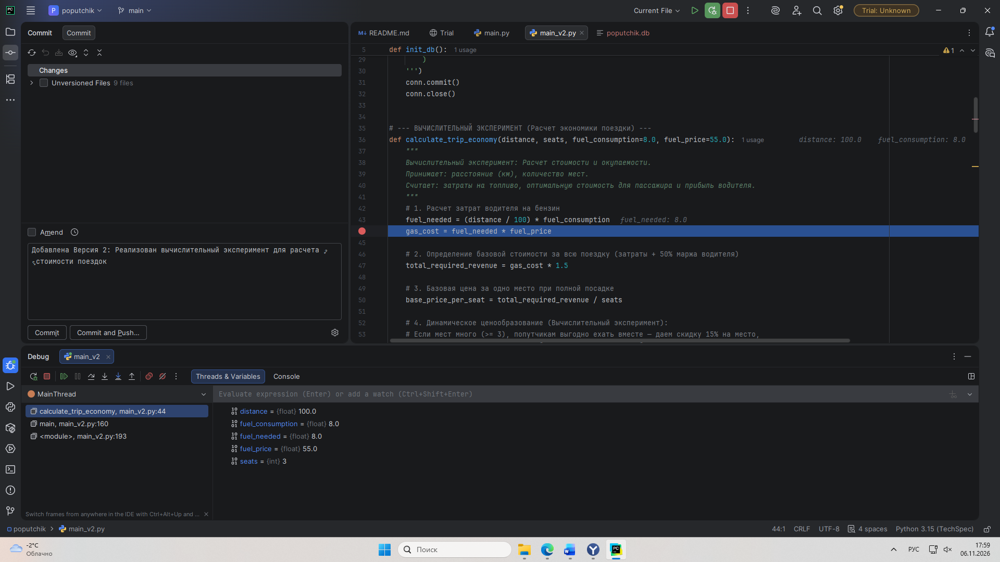

# Учебная практика по ПМ 03. Ревьюирование программных модулей

* **Специальность:** 09.02.07 Информационные системы и программирование  
* **Тема задания:** Вариант №18 — Сервис поиска попутчиков  
* **Выполнил:** студент Матросов  
* **Руководитель практики:** Шадрина Арина Юрьевна  

---

## 📌 Описание проекта
Данный репозиторий содержит результаты выполнения заданий по учебной практике. В рамках проекта разработан локальный программный модуль **«Сервис поиска попутчиков»**, автоматизирующий взаимодействие между водителями и пассажирами для совместных поездок. 

Интерфейс реализован в консольном виде на языке **Python**, данные надежно хранятся в реляционной СУБД **SQLite**.

---

## 📂 Структура репозитория и версии программы

В ходе практики были разработаны и зафиксированы две ключевые версии системы:
1. `main.py` (**Версия 1**) — Базовая архитектура приложения. Реализована инициализация базы данных (`users`, `trips`), регистрация и авторизация пользователей с разграничением прав («Водитель» / «Пассажир»), создание маршрутов и просмотр списка доступных машин.
2. `main_v2.py` (**Версия 2**) — Финальная версия программы, включающая в себя **вычислительный эксперимент**.

### 📊 Суть вычислительного эксперимента (Версия 2):
В финальную версию интегрирован интеллектуальный алгоритм расчета экономики поездки:
* Автоматически рассчитываются затраты водителя на топливо исходя из дистанции.
* Реализована система **динамического ценообразования**: если водитель берет много попутчиков (3 и более), система автоматически предоставляет пассажирам скидку в 15%, повышая привлекательность поездки.
* Вычисляется чистая прибыль водителя при полной посадке за вычетом ГСМ.

---

## 🛠 Технологический стек
* **Язык программирования:** Python 3.15
* **Среда разработки (IDE):** JetBrains PyCharm
* **База данных:** SQLite 3
* **Система контроля версий:** Git / GitHub

---

## 🐛 Инспекция кода и пошаговая отладка

В соответствии с пунктом 6 задания, была проведена отладка разработанного функционала. На строку начала вычислительного эксперимента (функция `calculate_trip_economy`) установлена точка останова (**Breakpoint**). 

Ниже представлен скриншот процесса пошаговой отладки, подтверждающий успешный контроль значений переменных в режиме реального времени:



---

## 🚀 Инструкция по запуску
Для запуска окончательной версии программы выполните команду в терминале:
```bash
python main_v2.py
```